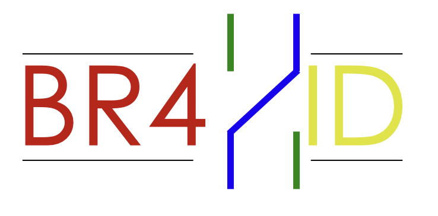

# Braid

  

An interactive digital board game based on the **Artin Braid Group ($B_4$)**, group theory and actions.

  <a href="https://generalizedabstractnonsense.github.io/BraidGame/">Website</a> ·
  <a href="#">Latest release</a> ·
  <a href="#">Issues</a>

    
    
    

---

## Note

This project started as an original physical board game concept and was brought to life through **AI-assisted programming** using the **free version of Google Gemini**. 
